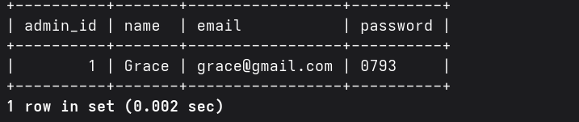
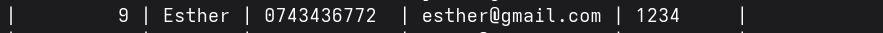
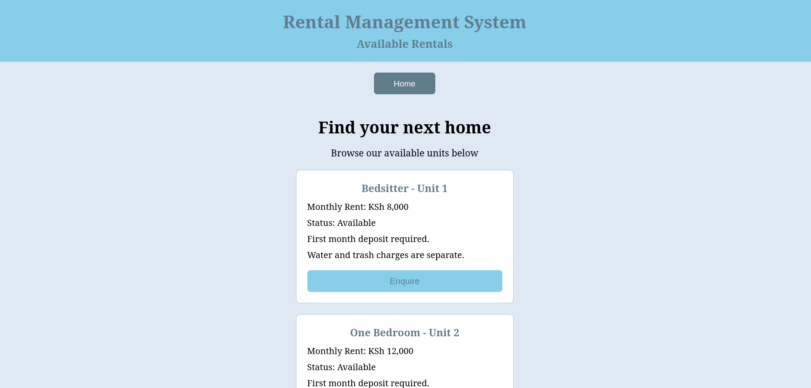
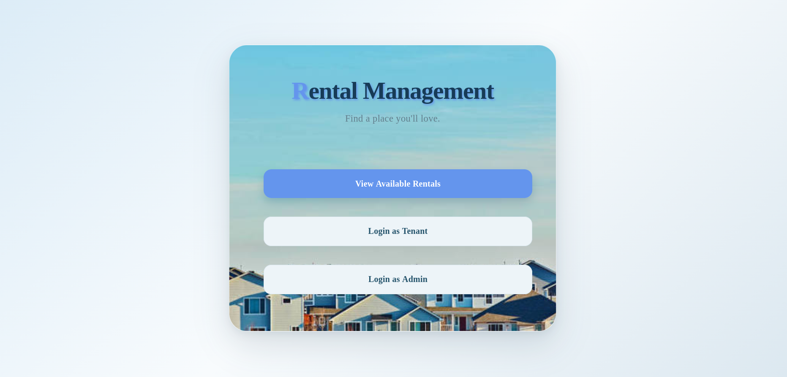
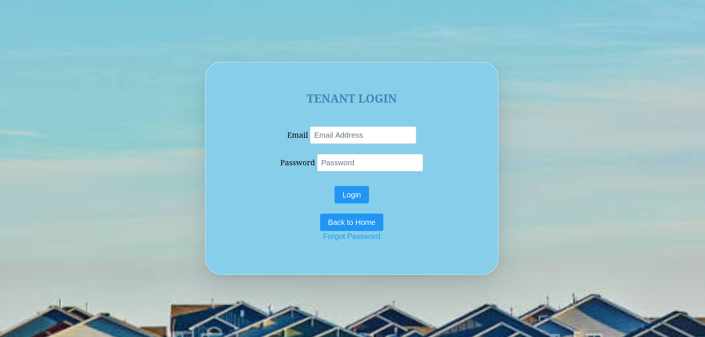
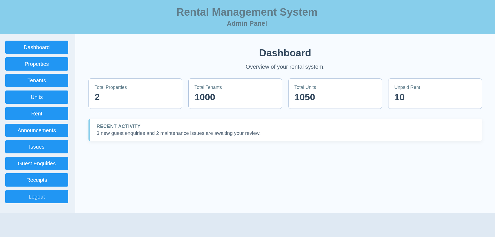
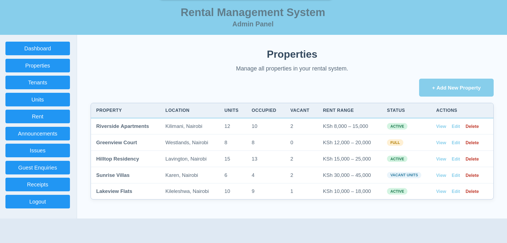
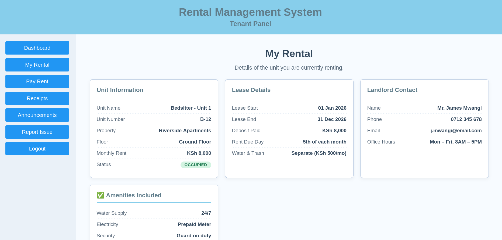

# Rental Management System (RMS)

A web-based Rental Management System built using Java, Jakarta EE, and PrimeFaces. The project provides a user interface for rental and property management, with separate Admin and Tenant sections.

**Project status:** Work in progress.

## Technologies Used

- Java
- Jakarta EE
- PrimeFaces
- Jakarta Faces (JSF)

## Features

- User login interface
- Dashboard with system statistics
- Property management interface
- Tenant management interface
- Payment management interface
- Financial reports
- Separate Admin and Tenant sections

## Development Status

The application is still under development. Most of the implemented interface and functionality are available, but some buttons and actions in the Admin and Tenant sections are not yet fully functional.

Further development and testing are ongoing.

## Getting Started

### 1. Clone the Repository

Open a terminal and run:

```bash
git clone https://github.com/esthergitome/RMS-Java.git
```

### 2. Navigate to the Project

```bash
cd RMS-Java/RMS/RentalManagementSystem
```

### 3. Open the Project

Open the project directory in a compatible Java IDE, such as NetBeans, IntelliJ IDEA, or Eclipse.

### 4. Configure and Run

Configure the Java environment, Jakarta EE application server, and any database or dependencies required by the project.

Build and deploy the application according to its project configuration.

**Note:** Additional setup instructions may be required depending on the project's build tool, application server, and database configuration.

## Project Structure

The application is located in:

`RMS/RentalManagementSystem`

The repository contains the source code and project files for the Rental Management System.

## Future Improvements

- Complete the remaining Admin and Tenant button functionality.
- Improve validation and error handling.
- Test the application's workflows.
- Refine the interface and user experience.
- Expand the setup and deployment documentation.

## Purpose

This project demonstrates practical development skills using Java, Jakarta EE, and PrimeFaces to build a web-based rental management application.

## Repository

**GitHub:** https://github.com/esthergitome/RMS-Java

The source code is available for viewing and cloning. Running the application requires the appropriate development environment and project dependencies.

Use the following demo accounts to explore the application.


Admin




Tenant



Important:

These credentials are for demonstration purposes only.

Use demo accounts with sample data, not real tenant information.

Some Admin and Tenant actions are still under development.

The application must be running in a configured environment to use these accounts.

## Screenshots

### Guest Page


### Sign in Page


### Login Page



### Admin Dashboard


### Property Management


### Tenant Dashboard

### Tenant Rental

